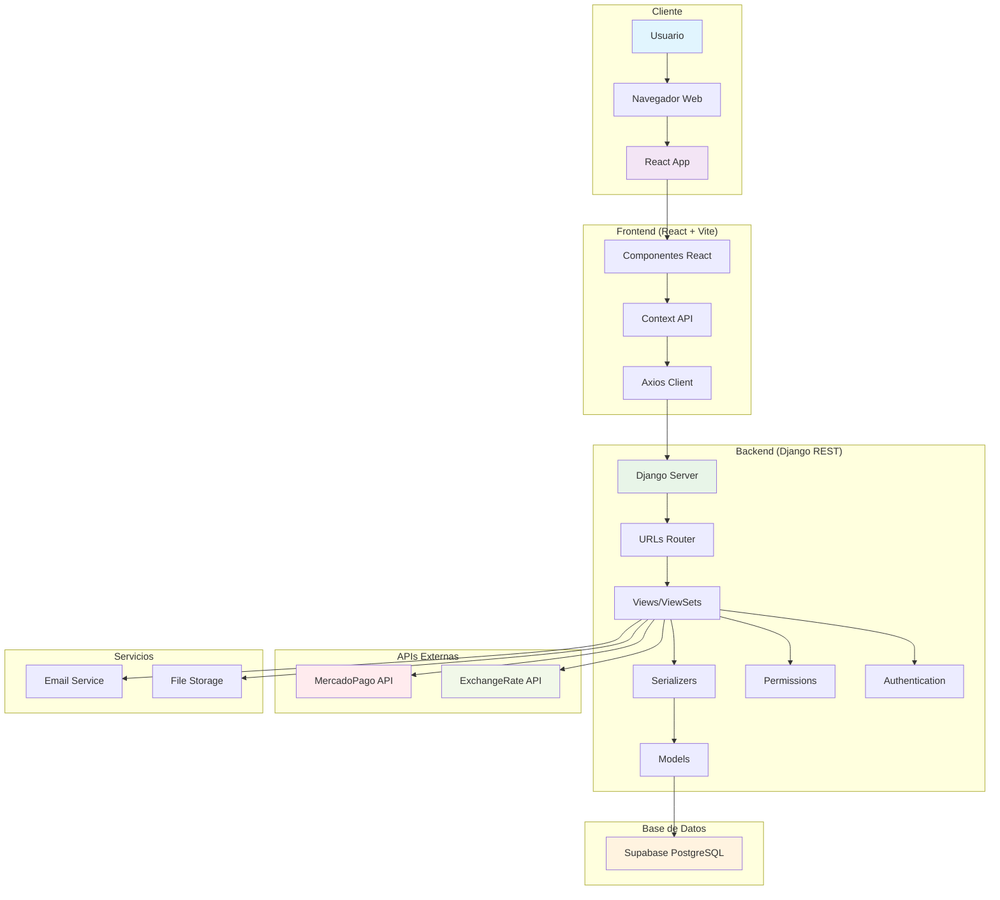
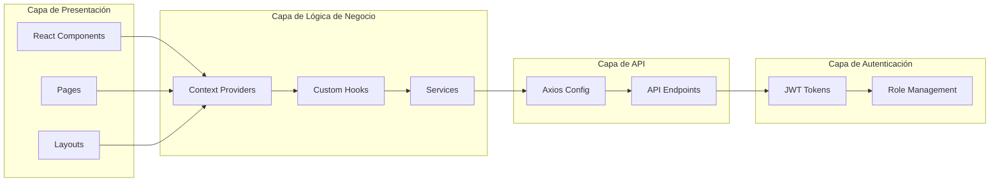
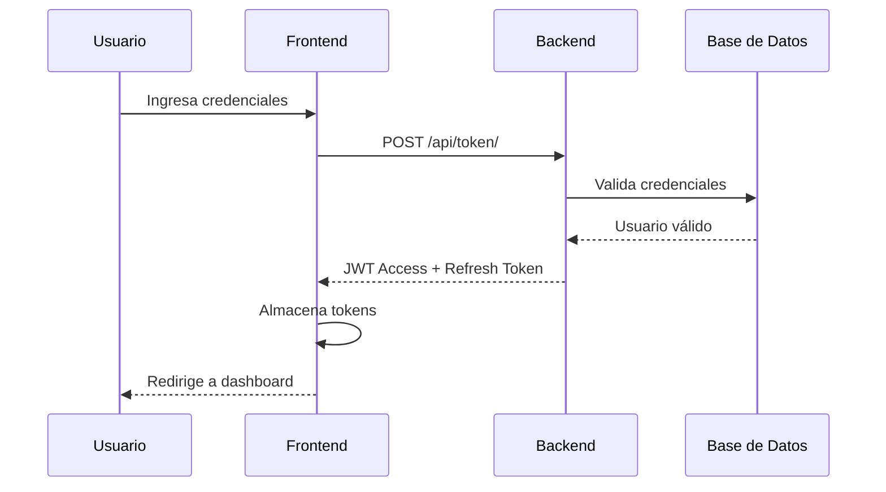
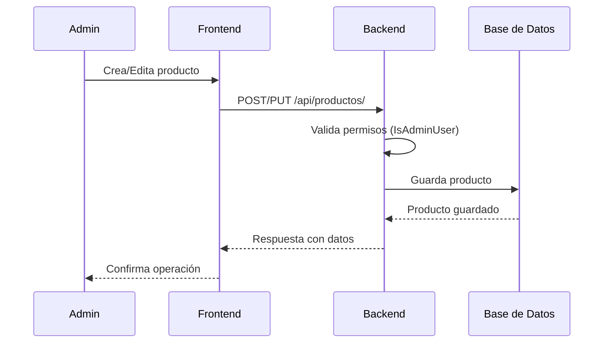
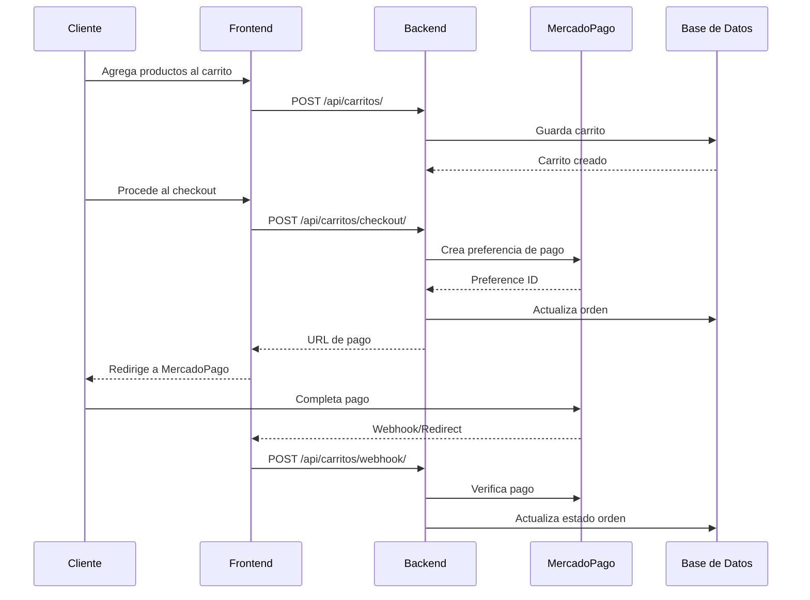
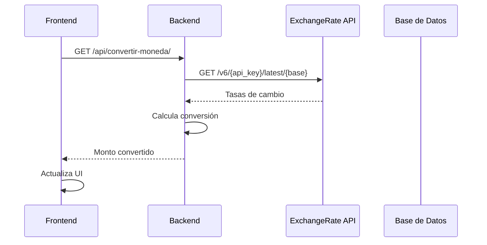

# 2. Arquitectura

## Diagrama de Arquitectura General



## Arquitectura de Capas



## Flujo de Datos

### 1. Flujo de Autenticación



### 2. Flujo de Gestión de Productos



### 3. Flujo de Carrito y Pagos



### 4. Flujo de Conversión de Monedas



## Estructura de Directorios

### Frontend (`ferremas_frontend/`)
```
src/
├── components/          # Componentes reutilizables
│   ├── Carrito/        # Componentes del carrito
│   ├── Checkout/       # Componentes de checkout
│   └── productos/      # Componentes de productos
├── context/            # Context API providers
├── hooks/              # Custom hooks
├── layouts/            # Layouts de página
├── pages/              # Páginas principales
│   ├── admin/          # Páginas de administración
│   ├── carrito/        # Páginas del carrito
│   ├── checkout/       # Páginas de checkout
│   └── productos/      # Páginas de productos
├── services/           # Servicios de API
├── utils/              # Utilidades
└── Styles/             # Estilos CSS
```

### Backend (`ferremas_backend/`)
```
├── config/             # Configuración de Django
│   ├── settings.py     # Configuración principal
│   ├── urls.py         # URLs principales
│   └── middleware.py   # Middleware personalizado
├── usuarios/           # App de gestión de usuarios
├── productos/          # App de gestión de productos
├── carrito/            # App del carrito y órdenes
├── conversor_monedas/  # App de conversión de monedas
├── contacto/           # App de contacto
└── manage.py           # Script de gestión de Django
```

## Patrones de Diseño Implementados

### 1. Model-View-Controller (MVC)
- **Models**: Django ORM models en cada app
- **Views**: Django REST Framework ViewSets y APIViews
- **Controllers**: Serializers que manejan la lógica de negocio

### 2. Repository Pattern
- Servicios encapsulan la lógica de acceso a datos
- Separación entre lógica de negocio y acceso a datos

### 3. Factory Pattern
- Creación de instancias de servicios externos (MercadoPago, ExchangeRate)

### 4. Observer Pattern
- Context API en React para manejo de estado global
- Webhooks para notificaciones de pagos

### 5. Strategy Pattern
- Diferentes estrategias de autenticación (JWT, Session)
- Múltiples métodos de pago (MercadoPago, otros en futuro)

## Comunicación entre Componentes

### Frontend ↔ Backend
- **Protocolo**: HTTP/HTTPS
- **Formato**: JSON
- **Autenticación**: JWT Bearer Token
- **CORS**: Configurado para desarrollo y producción

### Backend ↔ Base de Datos
- **ORM**: Django ORM
- **Conexión**: PostgreSQL a través de Supabase
- **Pooling**: Configurado automáticamente por Supabase

### Backend ↔ APIs Externas
- **MercadoPago**: SDK oficial de Python
- **ExchangeRate**: Requests HTTP client
- **Retry Logic**: Implementado para APIs externas

## Consideraciones de Escalabilidad

### Horizontal Scaling
- **Frontend**: Stateless, puede escalar horizontalmente
- **Backend**: Django con soporte para múltiples instancias
- **Base de Datos**: Supabase maneja escalabilidad automáticamente

### Vertical Scaling
- **Caching**: Implementar Redis para cache
- **CDN**: Para archivos estáticos e imágenes
- **Load Balancing**: Nginx o similar para distribución de carga

### Microservicios (Futuro)
- Separar servicios por dominio (usuarios, productos, pagos)
- API Gateway para enrutamiento
- Message Queue para comunicación asíncrona

## Seguridad

### Autenticación
- JWT tokens con expiración configurable
- Refresh tokens para renovación automática
- Blacklist de tokens revocados

### Autorización
- Permisos basados en roles (Admin, Trabajador, Cliente)
- Permisos granulares por operación
- Validación en frontend y backend

### Protección de Datos
- HTTPS obligatorio en producción
- Validación de entrada en todos los endpoints
- Sanitización de datos antes de almacenar
- CORS configurado apropiadamente

## Monitoreo y Logging

### Logging
- Django logging configurado
- Logs estructurados para debugging
- Rotación de logs automática

### Métricas
- Endpoints de health check
- Métricas de performance
- Monitoreo de APIs externas

### Alertas
- Notificaciones de errores críticos
- Alertas de disponibilidad de servicios
- Monitoreo de transacciones de pago 