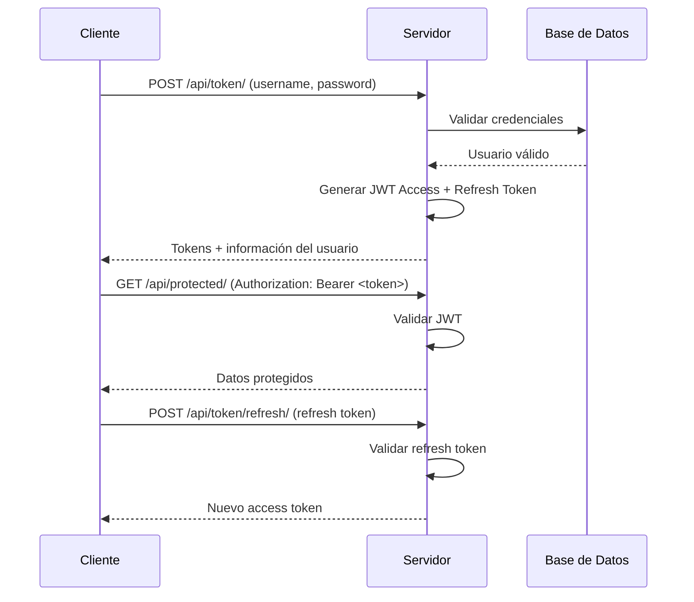

# 6. Seguridad

## Sistema de Autenticación

### JWT (JSON Web Tokens)

El sistema utiliza JWT para la autenticación de usuarios, proporcionando un mecanismo seguro y escalable.

#### Configuración JWT

```python
# settings.py
SIMPLE_JWT = {
    'ACCESS_TOKEN_LIFETIME': timedelta(days=1),
    'REFRESH_TOKEN_LIFETIME': timedelta(days=7),
    'ROTATE_REFRESH_TOKENS': True,
    'BLACKLIST_AFTER_ROTATION': True,
    'UPDATE_LAST_LOGIN': True,
    
    'ALGORITHM': 'HS256',
    'SIGNING_KEY': SECRET_KEY,
    'VERIFYING_KEY': None,
    'AUDIENCE': None,
    'ISSUER': None,
    'JWK_URL': None,
    'LEEWAY': 0,
    
    'AUTH_HEADER_TYPES': ('Bearer',),
    'AUTH_HEADER_NAME': 'HTTP_AUTHORIZATION',
    'USER_ID_FIELD': 'id',
    'USER_ID_CLAIM': 'user_id',
    'USER_AUTHENTICATION_RULE': 'rest_framework_simplejwt.authentication.default_user_authentication_rule',
    
    'AUTH_TOKEN_CLASSES': ('rest_framework_simplejwt.tokens.AccessToken',),
    'TOKEN_TYPE_CLAIM': 'token_type',
    'TOKEN_USER_CLASS': 'rest_framework_simplejwt.models.TokenUser',
    
    'JTI_CLAIM': 'jti',
    'SLIDING_TOKEN_REFRESH_EXP_CLAIM': 'refresh_exp',
    'SLIDING_TOKEN_LIFETIME': timedelta(days=1),
    'SLIDING_TOKEN_REFRESH_LIFETIME': timedelta(days=7),
}
```

#### Estructura del Token

```json
{
  "token_type": "access",
  "exp": 1642233600,
  "iat": 1642147200,
  "jti": "unique_token_id",
  "user_id": 1,
  "username": "usuario123",
  "rol": "cliente"
}
```

#### Flujo de Autenticación



### Roles y Permisos

#### Estructura de Roles

```python
# usuarios/models.py
class CustomerUser(AbstractUser):
    ROLES_CHOICES = [
        ('admin', 'Administrador'),
        ('trabajador', 'Trabajador'),
        ('cliente', 'Cliente'),
    ]
    
    rol = models.CharField(max_length=20, choices=ROLES_CHOICES, default='cliente')
    telefono = models.CharField(max_length=20, blank=True)
    requiere_cambio_password = models.BooleanField(default=False)
```

#### Permisos por Rol

| Rol | Permisos | Endpoints Accesibles |
|-----|----------|---------------------|
| **Admin** | Todos los permisos | Todos los endpoints |
| **Trabajador** | Gestión de productos, stock, órdenes | `/api/productos/`, `/api/stock-tienda/`, `/api/carritos/` |
| **Cliente** | Ver productos, gestionar carrito, perfil | `/api/productos/`, `/api/carritos/`, `/api/usuarios/perfil/` |

#### Implementación de Permisos

```python
# usuarios/permissions.py
from rest_framework import permissions

class IsAdminUser(permissions.BasePermission):
    """Permite acceso solo a usuarios administradores."""
    
    def has_permission(self, request, view):
        return request.user and request.user.is_authenticated and request.user.rol == 'admin'

class IsTrabajadorOrAdmin(permissions.BasePermission):
    """Permite acceso a trabajadores y administradores."""
    
    def has_permission(self, request, view):
        return request.user and request.user.is_authenticated and request.user.rol in ['trabajador', 'admin']

class IsOwnerOrAdmin(permissions.BasePermission):
    """Permite acceso al propietario del recurso o administradores."""
    
    def has_object_permission(self, request, view, obj):
        return (request.user.rol == 'admin' or 
                obj.usuario == request.user)
```

### Middleware de Seguridad

#### Middleware Personalizado

```python
# config/middleware.py
import time
from django.core.cache import cache
from django.http import HttpResponseForbidden

class RateLimitMiddleware:
    """Middleware para limitar el número de requests por IP."""
    
    def __init__(self, get_response):
        self.get_response = get_response
    
    def __call__(self, request):
        # Obtener IP del cliente
        ip = self.get_client_ip(request)
        
        # Verificar rate limit
        if self.is_rate_limited(ip):
            return HttpResponseForbidden("Rate limit exceeded")
        
        response = self.get_response(request)
        return response
    
    def get_client_ip(self, request):
        x_forwarded_for = request.META.get('HTTP_X_FORWARDED_FOR')
        if x_forwarded_for:
            ip = x_forwarded_for.split(',')[0]
        else:
            ip = request.META.get('REMOTE_ADDR')
        return ip
    
    def is_rate_limited(self, ip):
        cache_key = f"rate_limit_{ip}"
        requests_count = cache.get(cache_key, 0)
        
        if requests_count >= 100:  # 100 requests por minuto
            return True
        
        cache.set(cache_key, requests_count + 1, 60)  # 60 segundos
        return False

class SecurityHeadersMiddleware:
    """Middleware para agregar headers de seguridad."""
    
    def __init__(self, get_response):
        self.get_response = get_response
    
    def __call__(self, request):
        response = self.get_response(request)
        
        # Headers de seguridad
        response['X-Content-Type-Options'] = 'nosniff'
        response['X-Frame-Options'] = 'DENY'
        response['X-XSS-Protection'] = '1; mode=block'
        response['Strict-Transport-Security'] = 'max-age=31536000; includeSubDomains'
        response['Content-Security-Policy'] = "default-src 'self'; script-src 'self' 'unsafe-inline' 'unsafe-eval'; style-src 'self' 'unsafe-inline';"
        
        return response
```

## Validaciones en Formularios y Backend

### Validaciones de Entrada

#### Serializers con Validación

```python
# usuarios/serializers.py
from rest_framework import serializers
from django.contrib.auth.password_validation import validate_password
import re

class RegistroUsuarioSerializer(serializers.ModelSerializer):
    password2 = serializers.CharField(write_only=True)
    
    class Meta:
        model = CustomerUser
        fields = ['username', 'email', 'password', 'password2', 'first_name', 'last_name', 'telefono']
        extra_kwargs = {
            'password': {'write_only': True}
        }
    
    def validate_username(self, value):
        """Validar formato de username."""
        if len(value) < 3:
            raise serializers.ValidationError("El nombre de usuario debe tener al menos 3 caracteres.")
        
        if not re.match(r'^[a-zA-Z0-9_]+$', value):
            raise serializers.ValidationError("El nombre de usuario solo puede contener letras, números y guiones bajos.")
        
        return value
    
    def validate_email(self, value):
        """Validar formato de email."""
        if CustomerUser.objects.filter(email=value).exists():
            raise serializers.ValidationError("Este email ya está registrado.")
        return value
    
    def validate_password(self, value):
        """Validar fortaleza de la contraseña."""
        validate_password(value)
        return value
    
    def validate_telefono(self, value):
        """Validar formato de teléfono."""
        if value and not re.match(r'^\+?[1-9]\d{1,14}$', value):
            raise serializers.ValidationError("Formato de teléfono inválido.")
        return value
    
    def validate(self, attrs):
        """Validación cruzada de campos."""
        if attrs['password'] != attrs['password2']:
            raise serializers.ValidationError("Las contraseñas no coinciden.")
        return attrs
```

#### Validaciones de Productos

```python
# productos/serializers.py
from rest_framework import serializers
from decimal import Decimal

class ProductoSerializer(serializers.ModelSerializer):
    
    def validate_precio(self, value):
        """Validar que el precio sea positivo."""
        if value <= 0:
            raise serializers.ValidationError("El precio debe ser mayor a 0.")
        return value
    
    def validate_sku(self, value):
        """Validar formato único de SKU."""
        if not re.match(r'^[A-Z]{3,4}\d{3,6}$', value):
            raise serializers.ValidationError("El SKU debe tener el formato: LETRAS + NÚMEROS (ej: MART001)")
        
        # Verificar unicidad
        if self.instance is None:  # Nuevo producto
            if Producto.objects.filter(sku=value).exists():
                raise serializers.ValidationError("Este SKU ya existe.")
        
        return value
    
    def validate_stock(self, value):
        """Validar que el stock no sea negativo."""
        if value < 0:
            raise serializers.ValidationError("El stock no puede ser negativo.")
        return value
```

### Sanitización de Datos

#### Sanitización Automática

```python
# utils/sanitizers.py
import bleach
from django.utils.html import strip_tags

def sanitize_text(text):
    """Sanitiza texto HTML."""
    if not text:
        return text
    
    # Remover HTML tags
    clean_text = strip_tags(text)
    
    # Sanitizar con bleach
    allowed_tags = ['b', 'i', 'u', 'em', 'strong']
    allowed_attributes = {}
    
    sanitized_text = bleach.clean(
        clean_text,
        tags=allowed_tags,
        attributes=allowed_attributes,
        strip=True
    )
    
    return sanitized_text

def sanitize_filename(filename):
    """Sanitiza nombres de archivo."""
    import re
    # Remover caracteres especiales
    clean_filename = re.sub(r'[^a-zA-Z0-9._-]', '_', filename)
    return clean_filename
```

#### Middleware de Sanitización

```python
class DataSanitizationMiddleware:
    """Middleware para sanitizar datos de entrada."""
    
    def __init__(self, get_response):
        self.get_response = get_response
    
    def __call__(self, request):
        # Sanitizar datos POST/PUT
        if request.method in ['POST', 'PUT', 'PATCH']:
            if hasattr(request, 'data'):
                self.sanitize_data(request.data)
        
        response = self.get_response(request)
        return response
    
    def sanitize_data(self, data):
        """Sanitiza recursivamente los datos."""
        if isinstance(data, dict):
            for key, value in data.items():
                if isinstance(value, str):
                    data[key] = sanitize_text(value)
                elif isinstance(value, (dict, list)):
                    self.sanitize_data(value)
        elif isinstance(data, list):
            for item in data:
                self.sanitize_data(item)
```

## Control de Permisos y Protección de Datos Sensibles

### Protección de Datos Sensibles

#### Encriptación de Contraseñas

```python
# usuarios/models.py
from django.contrib.auth.hashers import make_password

class CustomerUser(AbstractUser):
    
    def save(self, *args, **kwargs):
        # Encriptar contraseña si se modificó
        if self._state.adding or self._password_changed:
            self.password = make_password(self.password)
        super().save(*args, **kwargs)
    
    @property
    def _password_changed(self):
        """Verifica si la contraseña fue modificada."""
        if self.pk:
            original = CustomerUser.objects.get(pk=self.pk)
            return original.password != self.password
        return True
```

#### Ocultación de Datos Sensibles

```python
# usuarios/serializers.py
class UsuarioListSerializer(serializers.ModelSerializer):
    """Serializer para listar usuarios sin datos sensibles."""
    
    class Meta:
        model = CustomerUser
        fields = ['id', 'username', 'first_name', 'last_name', 'rol', 'is_active', 'date_joined']
        read_only_fields = ['id', 'date_joined']

class UsuarioDetailSerializer(serializers.ModelSerializer):
    """Serializer para detalles de usuario con datos limitados."""
    
    class Meta:
        model = CustomerUser
        fields = ['id', 'username', 'email', 'first_name', 'last_name', 'telefono', 'rol', 'is_active']
        read_only_fields = ['id', 'email']  # Email no editable
```

### Auditoría y Logging

#### Sistema de Auditoría

```python
# utils/audit.py
import logging
from django.contrib.auth.models import AnonymousUser

audit_logger = logging.getLogger('audit')

def log_user_action(user, action, resource, details=None):
    """Registra acciones de usuario para auditoría."""
    if isinstance(user, AnonymousUser):
        user_id = 'anonymous'
        username = 'anonymous'
    else:
        user_id = user.id
        username = user.username
    
    log_entry = {
        'user_id': user_id,
        'username': username,
        'action': action,
        'resource': resource,
        'details': details,
        'timestamp': timezone.now().isoformat(),
        'ip_address': get_client_ip(request) if 'request' in locals() else None
    }
    
    audit_logger.info(f"AUDIT: {log_entry}")

def get_client_ip(request):
    """Obtiene la IP del cliente."""
    x_forwarded_for = request.META.get('HTTP_X_FORWARDED_FOR')
    if x_forwarded_for:
        ip = x_forwarded_for.split(',')[0]
    else:
        ip = request.META.get('REMOTE_ADDR')
    return ip
```

#### Decorador de Auditoría

```python
# utils/decorators.py
from functools import wraps
from .audit import log_user_action

def audit_action(action_name, resource_type):
    """Decorador para auditar acciones de usuario."""
    def decorator(view_func):
        @wraps(view_func)
        def wrapper(request, *args, **kwargs):
            # Ejecutar la vista
            response = view_func(request, *args, **kwargs)
            
            # Registrar la acción
            resource_id = kwargs.get('pk') or kwargs.get('id')
            log_user_action(
                user=request.user,
                action=action_name,
                resource=f"{resource_type}:{resource_id}",
                details={
                    'method': request.method,
                    'status_code': response.status_code,
                    'path': request.path
                }
            )
            
            return response
        return wrapper
    return decorator
```

### Protección CSRF

#### Configuración CSRF

```python
# settings.py
CSRF_COOKIE_SECURE = True  # Solo HTTPS
CSRF_COOKIE_HTTPONLY = True
CSRF_COOKIE_SAMESITE = 'Strict'
CSRF_TRUSTED_ORIGINS = [
    'https://tu-dominio.com',
    'https://www.tu-dominio.com'
]

# Middleware CSRF
MIDDLEWARE = [
    'django.middleware.security.SecurityMiddleware',
    'django.contrib.sessions.middleware.SessionMiddleware',
    'corsheaders.middleware.CorsMiddleware',
    'django.middleware.common.CommonMiddleware',
    'django.middleware.csrf.CsrfViewMiddleware',  # CSRF protection
    'django.contrib.auth.middleware.AuthenticationMiddleware',
    'django.contrib.messages.middleware.MessageMiddleware',
    'django.middleware.clickjacking.XFrameOptionsMiddleware',
]
```

### Protección XSS

#### Configuración XSS

```python
# settings.py
SECURE_BROWSER_XSS_FILTER = True
SECURE_CONTENT_TYPE_NOSNIFF = True

# Headers de seguridad adicionales
SECURE_REFERRER_POLICY = 'strict-origin-when-cross-origin'
```

#### Sanitización en Templates

```html
<!-- templates/base.html -->


<!DOCTYPE html>
<html>
<head>
    <meta charset="utf-8">
    <meta name="viewport" content="width=device-width, initial-scale=1">
    <meta http-equiv="X-Content-Type-Options" content="nosniff">
    <meta http-equiv="X-Frame-Options" content="DENY">
    <meta http-equiv="X-XSS-Protection" content="1; mode=block">
    
    <!-- CSP Header -->
    <meta http-equiv="Content-Security-Policy" 
          content="default-src 'self'; 
                   script-src 'self' 'unsafe-inline' 'unsafe-eval'; 
                   style-src 'self' 'unsafe-inline';
                   img-src 'self' data: https:;
                   font-src 'self' https:;">
    
    <title>Ferremas</title>
</head>
<body>
    
    
</body>
</html>
```

## Configuración de Seguridad por Entorno

### Desarrollo

```python
# settings_dev.py
DEBUG = True
ALLOWED_HOSTS = ['localhost', '127.0.0.1']

# Configuración de seguridad relajada para desarrollo
CORS_ALLOW_ALL_ORIGINS = True
SECURE_SSL_REDIRECT = False
SESSION_COOKIE_SECURE = False
CSRF_COOKIE_SECURE = False

# Logging detallado
LOGGING = {
    'version': 1,
    'disable_existing_loggers': False,
    'handlers': {
        'console': {
            'class': 'logging.StreamHandler',
        },
        'file': {
            'class': 'logging.FileHandler',
            'filename': 'debug.log',
        },
    },
    'loggers': {
        'django': {
            'handlers': ['console', 'file'],
            'level': 'DEBUG',
        },
        'audit': {
            'handlers': ['file'],
            'level': 'INFO',
        },
    },
}
```

### Producción

```python
# settings_prod.py
DEBUG = False
ALLOWED_HOSTS = ['tu-dominio.com', 'www.tu-dominio.com']

# Configuración de seguridad estricta
SECURE_SSL_REDIRECT = True
SECURE_PROXY_SSL_HEADER = ('HTTP_X_FORWARDED_PROTO', 'https')
SESSION_COOKIE_SECURE = True
CSRF_COOKIE_SECURE = True

# Headers de seguridad
SECURE_BROWSER_XSS_FILTER = True
SECURE_CONTENT_TYPE_NOSNIFF = True
X_FRAME_OPTIONS = 'DENY'
SECURE_REFERRER_POLICY = 'strict-origin-when-cross-origin'

# CORS restringido
CORS_ALLOWED_ORIGINS = [
    "https://tu-dominio.com",
    "https://www.tu-dominio.com",
]

# JWT más restrictivo
SIMPLE_JWT = {
    'ACCESS_TOKEN_LIFETIME': timedelta(hours=1),
    'REFRESH_TOKEN_LIFETIME': timedelta(days=7),
    'ROTATE_REFRESH_TOKENS': True,
    'BLACKLIST_AFTER_ROTATION': True,
    'UPDATE_LAST_LOGIN': True,
}

# Logging de producción
LOGGING = {
    'version': 1,
    'disable_existing_loggers': False,
    'formatters': {
        'verbose': {
            'format': '{levelname} {asctime} {module} {process:d} {thread:d} {message}',
            'style': '{',
        },
    },
    'handlers': {
        'file': {
            'class': 'logging.handlers.RotatingFileHandler',
            'filename': '/var/log/ferremas/app.log',
            'maxBytes': 1024*1024*10,  # 10MB
            'backupCount': 5,
            'formatter': 'verbose',
        },
        'security_file': {
            'class': 'logging.handlers.RotatingFileHandler',
            'filename': '/var/log/ferremas/security.log',
            'maxBytes': 1024*1024*10,  # 10MB
            'backupCount': 5,
            'formatter': 'verbose',
        },
    },
    'loggers': {
        'django': {
            'handlers': ['file'],
            'level': 'INFO',
        },
        'django.security': {
            'handlers': ['security_file'],
            'level': 'WARNING',
        },
        'audit': {
            'handlers': ['security_file'],
            'level': 'INFO',
        },
    },
}
```

## Monitoreo de Seguridad

### Detección de Intrusiones

```python
# security/monitoring.py
from django.core.cache import cache
from django.http import HttpResponseForbidden
import time

class SecurityMonitoringMiddleware:
    """Middleware para monitorear actividades sospechosas."""
    
    def __init__(self, get_response):
        self.get_response = get_response
    
    def __call__(self, request):
        # Verificar actividad sospechosa
        if self.detect_suspicious_activity(request):
            return HttpResponseForbidden("Actividad sospechosa detectada")
        
        response = self.get_response(request)
        return response
    
    def detect_suspicious_activity(self, request):
        """Detecta actividades sospechosas."""
        ip = self.get_client_ip(request)
        
        # Verificar intentos de login fallidos
        failed_logins = cache.get(f"failed_logins_{ip}", 0)
        if failed_logins > 5:  # Más de 5 intentos fallidos
            return True
        
        # Verificar requests anómalos
        request_count = cache.get(f"requests_{ip}", 0)
        if request_count > 1000:  # Más de 1000 requests por hora
            return True
        
        return False
    
    def get_client_ip(self, request):
        x_forwarded_for = request.META.get('HTTP_X_FORWARDED_FOR')
        if x_forwarded_for:
            ip = x_forwarded_for.split(',')[0]
        else:
            ip = request.META.get('REMOTE_ADDR')
        return ip
```

### Alertas de Seguridad

```python
# security/alerts.py
import smtplib
from email.mime.text import MIMEText
from django.conf import settings

def send_security_alert(subject, message):
    """Envía alertas de seguridad por email."""
    try:
        msg = MIMEText(message)
        msg['Subject'] = f"[FERREMAS SECURITY] {subject}"
        msg['From'] = settings.EMAIL_HOST_USER
        msg['To'] = settings.ADMIN_EMAIL
        
        with smtplib.SMTP(settings.EMAIL_HOST, settings.EMAIL_PORT) as server:
            server.starttls()
            server.login(settings.EMAIL_HOST_USER, settings.EMAIL_HOST_PASSWORD)
            server.send_message(msg)
            
    except Exception as e:
        logger.error(f"Error enviando alerta de seguridad: {e}")

def alert_failed_login(user, ip_address):
    """Alerta por intentos de login fallidos."""
    message = f"""
    Intento de login fallido detectado:
    
    Usuario: {user}
    IP: {ip_address}
    Timestamp: {timezone.now()}
    
    Se recomienda revisar la actividad de esta IP.
    """
    
    send_security_alert("Login Fallido", message)
```

## Checklist de Seguridad

### Configuración Inicial

- [ ] Cambiar SECRET_KEY por defecto
- [ ] Configurar DEBUG=False en producción
- [ ] Configurar ALLOWED_HOSTS
- [ ] Habilitar HTTPS
- [ ] Configurar CORS apropiadamente

### Autenticación y Autorización

- [ ] Implementar JWT con expiración
- [ ] Configurar refresh tokens
- [ ] Implementar blacklist de tokens
- [ ] Configurar roles y permisos
- [ ] Validar contraseñas fuertes

### Protección de Datos

- [ ] Encriptar contraseñas
- [ ] Sanitizar datos de entrada
- [ ] Implementar validaciones
- [ ] Proteger datos sensibles
- [ ] Configurar auditoría

### Headers de Seguridad

- [ ] X-Content-Type-Options: nosniff
- [ ] X-Frame-Options: DENY
- [ ] X-XSS-Protection: 1; mode=block
- [ ] Strict-Transport-Security
- [ ] Content-Security-Policy

### Monitoreo

- [ ] Configurar logging de seguridad
- [ ] Implementar detección de intrusiones
- [ ] Configurar alertas
- [ ] Monitorear logs regularmente
- [ ] Revisar auditoría periódicamente 